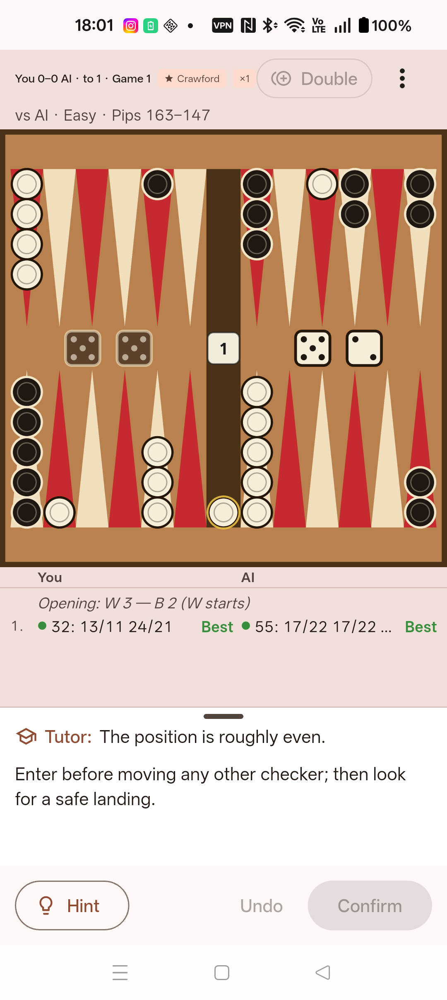
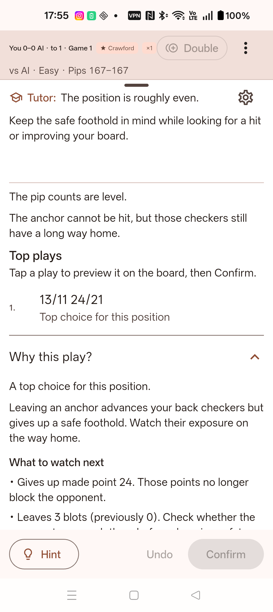
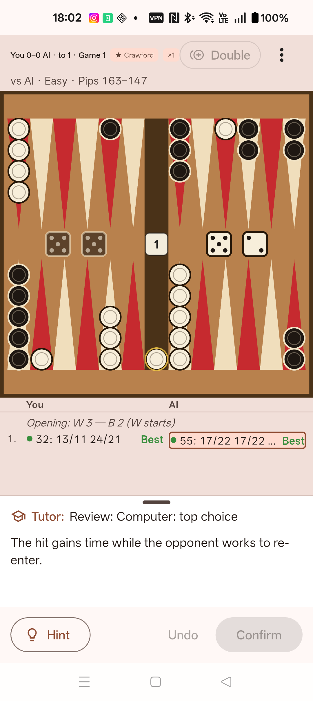

# Backgammon Buddy

**Play. Understand. Improve.**

Backgammon Buddy is a backgammon tutor by [Freevia](https://freevia.org/). Play
against the computer, see stronger moves with explanations grounded in the
position, and revisit decisions worth learning from.

[Website](https://freevia.org/backgammon-buddy/) ·
[Support](https://freevia.org/backgammon-buddy/support/) ·
[Privacy](https://freevia.org/backgammon-buddy/privacy/)

## See the app

  
  
  

These are real Android screenshots from an earlier 0.14.0 internal test build;
the current build may differ. [See the screenshots on the website](https://freevia.org/backgammon-buddy/#screenshots).

## Get the app

- **Google Play — Android:** [Get Backgammon Buddy](https://play.google.com/store/apps/details?id=org.freevia.backgammonbuddy). Version 0.16.2 (code 10150) is available to internal testers and has completed its 100% production rollout (last verified October 26, 2026).
- **GitHub 0.16.2:** [Android APK](https://github.com/freevia-org/backgammon-buddy/releases/download/v0.16.2/BackgammonBuddy-0.16.2-Android-10150.apk) · [Portable Windows x64 ZIP](https://github.com/freevia-org/backgammon-buddy/releases/download/v0.16.2/BackgammonBuddy-0.16.2-Windows-x64.zip) · [Release notes and source](https://github.com/freevia-org/backgammon-buddy/releases/tag/v0.16.2). Invited Android testers can use the [internal-test opt-in](https://play.google.com/apps/internaltest/4701280291485247000).
- **App Store — iOS:** Not available yet. Apple accepted version 0.16.2 (build 26) into App Store Connect, but it is not submitted for review. Version 0.16.0 remains under review; the owner chose to wait for that review before submitting the newer build. See the [current publishing status and remaining gates](docs/app-store-publishing.md).

## What you can do

- Play against the computer with on-device hints, move explanations and game commentary. Adjust how much help the tutor gives you.
- Review saved games, practise missed decisions and keep your progress on your device.
- Play hot-seat, nearby or online matches with other people. Live peer matches are unassisted; review comes afterward.

## Help shape Backgammon Buddy

[Get support](https://freevia.org/backgammon-buddy/support/) ·
[Share feedback or an idea](https://github.com/freevia-org/backgammon-buddy/issues/new?template=feature_request.yml) ·
[Report a bug](https://github.com/freevia-org/backgammon-buddy/issues/new?template=bug_report.yml)

GitHub issues are public. Remove private match codes, personal information and
unredacted diagnostics before posting. For a private matter, use
[Freevia support](https://freevia.org/backgammon-buddy/support/).

## Legal and data

[Privacy policy](https://freevia.org/backgammon-buddy/privacy/) ·
[Online-data deletion](https://freevia.org/backgammon-buddy/privacy/#retention) ·
[MIT license for Freevia's original code](LICENSE) ·
[Third-party notices](native/licenses/README.md)

Third-party code, models and data retain their own licenses and notices.
Builds containing GNUbg are distributed under GPL-3.0-or-later; see the
[GNUbg source and distribution notes](native/gnubg/README.md).

## For contributors

The app is built with Flutter and uses the vendored
[wildbg](https://github.com/carsten-wenderdel/wildbg) neural-net engine and
[GNU Backgammon](native/gnubg/README.md). Settings selects the primary engine
and optionally enables side-by-side tutor analysis in independent workers.
The [technical reference](docs/technical-reference.md) preserves the detailed
repository layout, development setup, architecture and CI notes from the
previous README. See the [release-readiness checklist](docs/release-readiness.md)
for candidate checks; it is not a public-install page.
